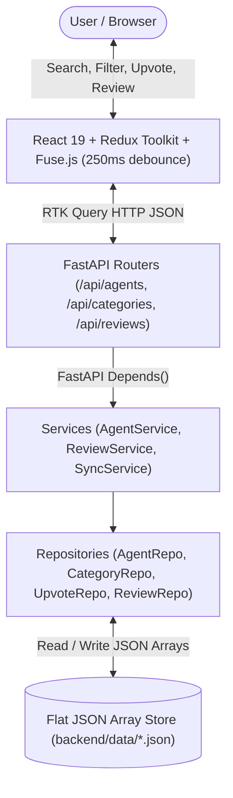

# Agents Directory & Profiles — Architecture

## Overview

The Agents Directory & Profile feature is the core catalog of **AgentHub**, combining a React 19 + RTK Query + Fuse.js multi-faceted interface with a 4-tier FastAPI backend (`routers` → `services` → `repositories` → `backend/data/*.json`), exponential time-decay ranking, community reviews, and deduplicated upvotes.

---

## Data Persistence & Pydantic v2 Schemas

All entities are stored as root-level JSON arrays (`[...]`) in `backend/data/` and validated via Pydantic v2 models in `backend/app/models/`.

### 1. `backend/data/agents.json` (`AgentInDb`)

- **Identity & Copy**: `id` (UUID), `slug` (unique URL key), `title`, `tagline`, `summary` (≤ 120 chars), `description_markdown`.
- **Links & Metrics**: `logo_url`, `website_url`, `repository_url`, `github_stars`, `upvotes_count`.
- **Technical Telemetry**: `category_id`, `deployment_targets` (`local_cli`, `docker`, `cloud_saas`, `ide_extension`), `llm_backends`, `framework`, `is_open_source`, `is_mcp_compliant`, `hardware_requirements`, `terminal_setup_script`, `strengths`, `known_edge_cases`.
- **5 Benchmark Dimensions**: `autonomy_level`, `has_vector_rag`, `memory_backend`, `multimodal_capabilities`, `token_overhead_tier`, `maintenance_cadence`.
- **Lifecycle & Audit**: `lifecycle_state` (`pending` | `approved` | `rejected`), `is_archived`, `submitter_email`, `created_at` (UTC), `updated_at` (UTC).

### 2. `backend/data/upvotes.json` (`UpvoteRecord`)

Deduplicates community votes per `(agent_id, user_id | digital_fingerprint_hash)`. Repeated requests from the same client fingerprint toggle (revoke) the existing upvote cleanly.

### 3. `backend/data/categories.json` & `backend/data/reviews.json`

- `categories.json`: 5 canonical domains (`coding-devops`, `web-browser-automation`, `research-data-analysis`, `sales-outreach`, `multi-agent-frameworks`).
- `reviews.json`: Community benchmark reviews (`id`, `agent_id`, `author_name`, `author_role`, `rating` 1–5, `comment`, `created_at`).

---

## Ranking Algorithm

Trending scores are computed deterministically in `AgentService.calculate_ranking_score`:

$$\text{Score} = \frac{\text{Upvotes}_{7\text{d}} + 1}{(\text{Age}_{\text{hours}} + 2)^{1.5}}$$

- Rolling 168-hour (7-day) upvote window with `+1` Laplace smoothing and `+2` hour stabilization offset.

---

## Frontend Search & State Pipeline

- **RTK Query (`agentsApi.ts`)**: Fetches `/api/agents` and `/api/categories`, caching responses and automatically invalidating `'Agent'` / `'Review'` tags on mutations.
- **250ms Debounce + `Fuse.js`**: User search input is debounced by 250ms before querying an in-memory `Fuse` index (`threshold: 0.35`) weighted across `name` (`0.4`), `tagline` (`0.25`), `framework` (`0.15`), `primaryLlm` (`0.1`), and `category` (`0.1`).
- **Bidirectional URL Sync (`App.tsx`)**: Active view, profile slug, search query, and filter parameters synchronize with `window.location.search`.

---

## API Surface

| Method | Endpoint | Description |
| :--- | :--- | :--- |
| `GET` | `/api/agents` | Filtered & sorted catalog with calculated `ranking_score` |
| `GET` | `/api/agents/{slug}` | Full technical audit profile (`AgentDetailResponse`) |
| `GET` | `/api/agents/{slug}/alternatives` | Contextual alternatives in the same category |
| `POST` | `/api/agents/{agent_id}/upvote` | Toggle deduplicated upvote by `digital_fingerprint_hash` |
| `GET` | `/api/categories` | List all 5 functional agent categories |
| `GET` | `/api/agents/{slug}/reviews` | List community benchmark reviews for an agent |
| `POST` | `/api/agents/{agent_id}/reviews` | Submit a 1–5 star technical audit review |
