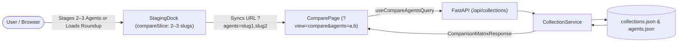

# Curated Collections & Side-by-Side Comparisons — Architecture

## Overview

The Collections & Comparisons feature (`ComparePage.tsx`, `StagingDock.tsx`, `CollectionService`) combines curated editorial roundups (`backend/data/collections.json`) with an interactive 2–3 agent side-by-side matrix across 5 standardized engineering benchmark dimensions.

---

## 5 Standardized Engineering Benchmark Parameters

| # | Parameter | `AgentInDb` Field(s) | Values / Examples |
| :--- | :--- | :--- | :--- |
| **1** | **Degree of Execution Autonomy** | `autonomy_level` | `fully_autonomous`, `semi_autonomous`, `copilot` |
| **2** | **Vector Memory & RAG Integration** | `has_vector_rag`, `memory_backend` | `true` (`Chroma`, `FAISS`, `Tree-sitter Graph`) / `false` |
| **3** | **Multimodal Asset Handling** | `multimodal_capabilities` | `screenshots`, `browser_dom`, `file_diffs`, `pdf_parsing` |
| **4** | **Estimated Token Consumption Overhead** | `token_overhead_tier` | `low`, `moderate`, `heavy` |
| **5** | **Community Maintenance Cadence** | `maintenance_cadence` | `weekly_releases`, `monthly_releases`, `infrequent` |

`CollectionService.compare_agents` also computes `is_cross_category: bool` to surface a contextual warning banner when comparing agents across different functional domains, and `ComparePage.tsx` supports one-click export as a Markdown Architecture Decision Record (ADR) table.

---

## API Surface

| Method | Endpoint | Query Parameters | Description |
| :--- | :--- | :--- | :--- |
| `GET` | `/api/collections` | — | List curated collections hydrated with `featured_agents` |
| `GET` | `/api/collections/{slug}` | — | Fetch single curated collection by slug |
| `GET` | `/api/collections/compare/matrix` | `agents=slug1,slug2[,slug3]` | Return normalized 5-parameter comparison matrix for 2–3 agents |
