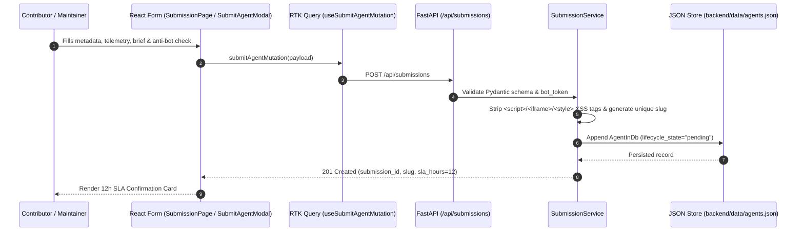
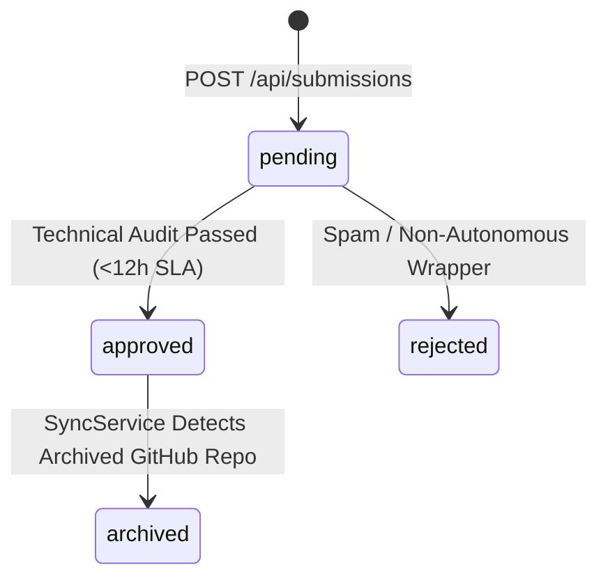

# Community Submission Portal — Architecture

## Overview

The Community Submission Portal (`SubmissionPage.tsx` and `SubmitAgentModal.tsx`) manages contributor intake through client validation, bot mitigation verification, Pydantic v2 schema checks, XSS Markdown sanitization, and persistence into `backend/data/agents.json` with `lifecycle_state = "pending"` and a 12-hour review SLA.

---

## Moderation Lifecycle State Machine

---

## Schema Validation & Security (`SubmissionCreateRequest`)

- **Field Constraints**: `title` (2–150 chars), `tagline` (5–255 chars), `summary` (≤ 120 chars), `description_markdown` (≥ 20 chars), valid `http(s)://` URLs for `website_url` / `repository_url`, regex-validated `submitter_email`, and verified `category_id` (UUID or category slug).
- **Bot Mitigation**: Rejects automated abuse tokens (`bot_token == "bot_fail"` → `403 Forbidden`).
- **XSS Sanitization**: `SubmissionService.submit_agent` strips `<script>`, `<iframe>`, and `<style>` blocks from `description_markdown` prior to persistence.

---

## API Surface

| Method | Endpoint | Request Schema | Response | Description |
| :--- | :--- | :--- | :--- | :--- |
| `POST` | `/api/submissions` | `SubmissionCreateRequest` | `201 Created` (`SubmissionResponse`) | Commit a new agent to the `pending` moderation queue with 12h SLA |
